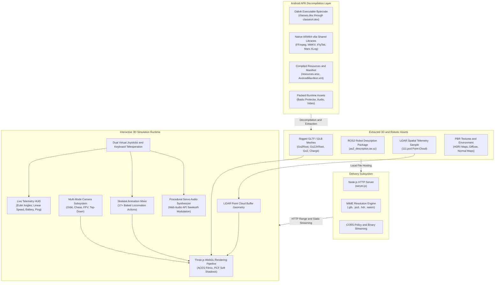

# Unitree Go2 Application Reverse Engineering and 3D Simulation Platform

## Overview

This repository contains the decompiled source, unpacked assets, native libraries, and an interactive WebGL 3D digital twin simulator extracted from the official Unitree Go2 quadruped robot Android mobile application.

The project provides an engineering foundation for analyzing Unitree Go2 application internals, extracting robotic assets (including skeletal GLB meshes, ROS2 URDF definitions, and 4D LiDAR point clouds), and executing real-time web-based simulation with kinematic animation playback, telemetry monitoring, and teleoperation controls.

---

## System Architecture

The following diagram illustrates the data flow and system architecture, spanning APK extraction, asset processing, local streaming delivery, and WebGL digital twin rendering.



---

## Architectural Subsystems

### 1. Android Application Decompilation Layer
- **Dalvik Executables (`classes.dex` - `classes4.dex`)**: The core compiled Java/Kotlin bytecode powering the mobile application, covering robot networking, Bluetooth Low Energy (BLE) pairing, WebRTC video streaming, and telemetry handling.
- **Native Shared Libraries (`lib/arm64-v8a/`)**: C/C++ compiled ELF libraries providing low-level performance routines:
  - `libavcodec.so`, `libavformat.so`, `libavutil.so`, `libswscale.so`: Hardware-accelerated media streaming pipeline based on FFmpeg.
  - `libmmkv.so`: High-performance key-value storage engine developed by Tencent.
  - `libmsc.so`: iFlyTek acoustic and speech recognition engine.
  - `libtbmarsxlog.so`: Cross-platform reliable logging framework.
  - `libbaiduprotect.so`: Binary packing and anti-tamper shell protection modules.

### 2. Extracted Robotic Asset Pipeline
- **Rigged 3D Meshes**: High-fidelity GLTF 2.0 binary (`.glb`) models containing the complete kinematic skeleton, joint constraints, and material definition for the Go2 quadruped and its robotic arm variant.
- **Robot Description Format**: An unpacked ROS2 robot description archive (`as2_description.tar.xz`) containing URDF specifications, mesh references, and joint kinematic limits.
- **LiDAR Point Cloud Telemetry**: Real spatial capture (`111.pcd`) generated by the Unitree 4D LiDAR L1 sensor, formatted in ASCII PCD with XYZ coordinate positions and reflectance intensity values.
- **PBR Lighting and Textures**: Venice Sunset 1K 32-bit radiance map (`.hdr`), normal maps, diffuse ground layers, and procedural noise maps for realistic surface shading.

### 3. Serving Subsystem (`server.js`)
- Zero-dependency Node.js HTTP server.
- Built-in MIME dictionary supporting 3D models (`model/gltf-binary`), point clouds (`text/plain`), HDR radiance maps (`application/octet-stream`), and WebAssembly modules (`application/wasm`).
- Enabled Cross-Origin Resource Sharing (`Access-Control-Allow-Origin: *`) to ensure seamless texture and buffer loading across local network interfaces.

### 4. Interactive WebGL Simulation Runtime
- **Rendering Engine**: Three.js (r160) WebGL renderer with PCF soft shadow maps, dynamic fog, and ACES Filmic tone mapping.
- **Kinematic Animation Controller**: Cross-faded skeletal action transitions across 17 pre-baked locomotion states.
- **Multi-Camera Rig**:
  - *Orbit Camera*: Free-look orbital navigation around the robot with floor-clipping safeguards.
  - *Chase Camera*: Dynamic third-person tracking behind the robot following translation and yaw.
  - *FPV Camera*: First-person perspective mounted on the Go2 sensor head.
  - *Top-Down Camera*: Orthographic perspective for spatial orientation and path tracking.
- **Procedural Servo Motor Synthesizer**: Web Audio API oscillator producing dynamic frequency sweeps and volume modulation simulating brushless DC joint actuator feedback during movement.

---

## Repository Layout

```
.
|-- AndroidManifest.xml              # Binary/extracted Android manifest definition
|-- DebugProbesKt.bin                # Kotlin coroutines debugging metadata
|-- LICENSE-junit.txt                # JUnit dependency license
|-- README.md                        # Project documentation and architectural manual
|-- server.js                        # Node.js static asset streaming server
|-- classes.dex                      # Primary Dalvik executable
|-- classes2.dex                     # Secondary Dalvik executable (Android multi-dex)
|-- classes3.dex                     # Tertiary Dalvik executable
|-- classes4.dex                     # Quaternary Dalvik executable
|-- resources.arsc                   # Compiled Android application resource table
|-- .gitattributes                   # Git LFS tracking rules for binary assets
|
|-- assets/
|   |-- baiduprotect*.jar            # Decompiled anti-tamper wrapper archives
|   |-- baiduprotect*.dex            # Anti-tamper stub executables
|   |-- call.bnf / grammar_sample    # Speech recognition grammar definitions
|   |-- iattest.wav / isetest.wav    # Audio calibration and testing samples
|   |-- standard_h1.mp4              # Official Unitree H1 humanoid demo video
|   `-- dist/                        # Production web application and simulator root
|       |-- blank.html               # Full-screen interactive 3D simulator
|       |-- simulator.html           # Simulator entrypoint
|       |-- index.html               # Default web landing page
|       |-- 111.pcd                  # Unitree 4D LiDAR L1 point cloud sample
|       |-- time.json                # Build timing metadata
|       |-- vite.svg                 # Application vector icon
|       |-- js/                      # Extracted web modules and engines
|       |   |-- PCDLoader/           # Point cloud parsing subsystem
|       |   |-- Programming/         # Blockly visual programming framework
|       |   |-- ProgrammingSuperstar/# Extended robotics visual scripting blocks
|       |   |-- js-interpreter/      # In-browser sandboxed JavaScript interpreter
|       |   |-- robot/               # Robot controller state machine
|       |   |-- slam/                # SLAM mapping and path visualization
|       |   |-- store/               # Pinia / Vuex state stores
|       |   `-- vconsole.min/        # On-device debugging overlay
|       `-- models/                  # 3D models and rendering assets
|           |-- Go2Root.glb          # Full Go2 quadruped model with skeletal animations
|           |-- Go2JXRoot.glb        # Go2 quadruped equipped with JX robotic arm
|           |-- Go2.glb              # Standard Go2 chassis model
|           |-- Go2JX.glb            # Go2 chassis with JX arm mount
|           |-- charge.glb           # Autonomous charging dock station model
|           |-- environment.glb      # 3D test arena and terrain model
|           |-- as2_description.tar  # ROS2 URDF kinematic description package
|           |-- venice_sunset_1k.hdr # 32-bit HDRI radiance environment map
|           `-- *.jpg / *.png        # PBR diffuse, normal, and cubemap textures
|
`-- lib/
    `-- arm64-v8a/                   # Native 64-bit ARM compiled shared objects
        |-- libavcodec.so            # FFmpeg codec library
        |-- libavformat.so           # FFmpeg container and muxing library
        |-- libavutil.so             # FFmpeg utility functions
        |-- libswscale.so            # FFmpeg image scaling and colorspace conversion
        |-- libffmpegkit.so          # FFmpegKit Android wrapper
        |-- libmmkv.so               # Tencent MMKV high-speed key-value store
        |-- libmsc.so                # iFlyTek Mobile Speech Client native library
        |-- libtbmarsxlog.so         # Tencent Mars Xlog logging library
        `-- libcrash-analysis*.so    # Application crash telemetry handlers
```

---

## 3D Models and Digital Twin Assets

| Asset File | Size | Rigging / Skeleton | Description |
|:---|:---:|:---:|:---|
| `Go2Root.glb` | 6.96 MB | Yes (Root Joint + 12 Actuators) | Complete Go2 quadruped mesh featuring 17 embedded skeletal animation clips. |
| `Go2JXRoot.glb` | 9.86 MB | Yes (Go2 + JX Manipulator) | Go2 quadruped equipped with the 6-DOF robotic arm attachment. |
| `Go2.glb` | 6.24 MB | Static / Base Rig | Quadruped base chassis model without extended root accessories. |
| `Go2JX.glb` | 8.63 MB | Static / Base Rig | Robotic arm variant base chassis model. |
| `charge.glb` | 27.8 KB | Static Mesh | Autonomous ground docking and induction charging station. |
| `environment.glb` | 1.95 MB | Static Mesh | Obstacle course and arena mesh for simulation testing. |
| `111.pcd` | 795 KB | Spatial Point Cloud | 3D point cloud dataset captured from Go2 4D LiDAR L1 sensor. |
| `as2_description.tar.xz` | 2.87 MB | URDF Specification | Complete ROS2 package containing URDF kinematics, limits, and visual meshes. |

### Embedded Skeletal Animation Clips
The `Go2Root.glb` and `Go2JXRoot.glb` models contain pre-calculated animation tracks accessible through the Three.js `AnimationMixer`:
- `StandUp`: Transition from ground sitting posture to active quadruped stance.
- `Sit`: Lowering sequence into resting position.
- `Hello`: Foreleg waving greeting gesture.
- `Stretch`: Full-body spinal and leg extension routine.
- `Dance1`: Dynamic rhythmic locomotion sequence.
- Locomotion cycles: Forward walk, backward walk, turning, and dynamic trotting gaits.

---

## Simulator Features and Technical Stack

### WebGL 3D Engine
- **Three.js (r160)**: Core rendering engine executing via WebGL 2.0.
- **Lighting Model**:
  - Key Directional Sun light with 2048x2048 PCF soft shadow maps.
  - Dual cyber rim spotlights (Cyan #00F0FF and Amber #FF8800) for edge definition.
  - Dual dynamic LED headlights mounted directly on the robot chassis emitting cone spotlights.
  - Infinite coordinate floor grid with ground shadow receiver.
- **PBR Pipeline**: Metallic-roughness material evaluation with environment map reflections.
- **Point Cloud Visualization**: Custom PCD parser mapping Cartesian coordinates `(X, Z, -Y)` with intensity-based HSL color gradients.

### Audio Synthesis Subsystem
- Real-time procedural audio synthesis built on the standard Web Audio API.
- Sawtooth oscillator generating 120 Hz to 200 Hz tone sweeps proportional to robot movement speed.
- Exponential gain envelopes producing interface feedback chimes during state changes.

### Telemetry Processing
- Real-time Euler orientation calculation (Pitch, Roll, Yaw) derived from robot transformation matrices.
- Dynamic altitude calculation based on bounding box floor clearance.
- Linear speed integration factoring translation vectors over frame delta time.

---

## Getting Started

### Prerequisites
- Node.js (v16.0.0 or higher recommended)
- Git and Git LFS (Large File Storage)
- Modern web browser with WebGL 2.0 support (Chrome, Edge, Firefox, or Safari)

### 1. Clone the Repository with Git LFS
Ensure Git LFS is installed and initialized before cloning to pull large binary files (`.glb`, `.dex`, `.so`, `.hdr`, `.pcd`):

```bash
git lfs install
git clone https://github.com/Thilac01/Unitree_App_RE_Unpack.git
cd Unitree_App_RE_Unpack
git lfs pull
```

### 2. Verify Large File Storage Pull
Verify that the 3D model files are actual binaries and not pointer stubs:

```bash
# Windows PowerShell
Get-Item assets/dist/models/Go2Root.glb | Select-Object Name, Length

# Linux / macOS
ls -lh assets/dist/models/Go2Root.glb
```
*The file size of `Go2Root.glb` should be approximately 6.96 MB.*

### 3. Launch the Local Streaming Server
Start the built-in HTTP server:

```bash
node server.js
```

The console will indicate that the server is operational:
```
Unitree 3D Simulator Server running at:
- http://localhost:8080/simulator.html
- http://127.0.0.1:8080/simulator.html
- http://127.0.0.1:8080/index.html
```

### 4. Access the Simulator
Open your browser and navigate to:
```
http://localhost:8080/blank.html
```
or
```
http://localhost:8080/simulator.html
```

---

## Teleoperation and Controls Guide

### Keyboard Controls

| Key | Action | Function |
|:---:|:---|:---|
| `W` | Move Forward | Drives the quadruped forward along its local heading |
| `S` | Move Backward | Reverses the quadruped |
| `A` | Rotate Left | Rotates chassis heading counter-clockwise (Yaw +) |
| `D` | Rotate Right | Rotates chassis heading clockwise (Yaw -) |
| `Q` | Strafe Left | Lateral translation to the left |
| `E` | Strafe Right | Lateral translation to the right |
| `Space` | Jump / Reset | Resets linear velocity and triggers stance reset |

### Touch and On-Screen Joysticks
- **Left Virtual Joystick (Translation)**: Controls linear surge (forward/backward) and sway (left/right strafe).
- **Right Virtual Joystick (Rotation)**: Controls angular heading (yaw) and pitch viewing angle.

### Camera Switching

| Control | Mode | Behavior |
|:---|:---|:---|
| **Orbit Cam** | Spherical Free Orbit | Full 360-degree rotation with mouse drag, zoom with scroll wheel |
| **Chase Cam** | Third-Person Tracking | Smoothly tracks behind the robot with position interpolation |
| **Robot FPV** | First-Person View | Mounts camera directly on the robot sensor head |
| **Top Down** | Orthographic Overview | Overhead perspective for inspecting motion and positioning |

### Simulation Feature Toggles
- **LED Headlights**: Toggles front chassis dual spotlight illumination.
- **3D LiDAR Point Cloud**: Loads and overlays spatial points from `111.pcd`.
- **Wireframe Mode**: Displays raw polygonal mesh topology.
- **Servo Audio Synth**: Enables dynamic audio feedback for joint movement.
- **Auto-Rotate Cam**: Rotates the camera continuously around the focal point.

---

## Reverse Engineering Technical Details

### Multi-DEX Architecture
The application is partitioned across 4 Dalvik executables (`classes.dex` through `classes4.dex`) due to method count limits:
- `classes.dex`: Core Android application runtime, dependency injection, and UI controllers.
- `classes2.dex`: Communication libraries, WebRTC streaming protocols, and serialization codecs.
- `classes3.dex`: Sensor telemetry processing, visual computing bindings, and audio services.
- `classes4.dex`: Third-party vendor SDKs, analytics, and security verification hooks.

### Baidu Protect Analysis
The unpacked assets include components associated with Baidu Protect (`baiduprotect*.jar`, `baiduprotect*.dex`, `libbaiduprotect.so`):
- Operates as a runtime unpacking stub designed to prevent static inspection.
- Employs class encryption, dynamic code loading, and anti-debugging integrity checks.
- Native stub `libbaiduprotect.so` handles JNI-level verification before transferring execution to the main application entry point.

### Embedded Web Client and Visual Programming
Located within `assets/dist/js/`, the application embeds a complete web-based Blockly runtime:
- `Programming/` and `ProgrammingSuperstar/`: Visual block sets allowing users to construct robot automation pipelines (sensor triggers, motion sequences, conditional actions).
- `js-interpreter/`: Sandboxed JavaScript engine running on the client to evaluate generated Blockly code safely.
- `slam/`: Visualization routines for map building and path planning representation.

---

## Security, Legal, and Compliance Notice

This repository and its contents are provided strictly for educational, security research, and interoperability analysis purposes.
- All trademarks, service marks, trade names, and product names (including "Unitree", "Unitree Go2", and associated brand assets) are the intellectual property of Hangzhou Yushu Technology Co., Ltd. (Unitree Robotics).
- This project is an independent research effort and is not affiliated with, sponsored by, or endorsed by Unitree Robotics.
- Users are responsible for ensuring that their use of these extracted materials complies with applicable local laws, reverse engineering exceptions, and intellectual property regulations.
